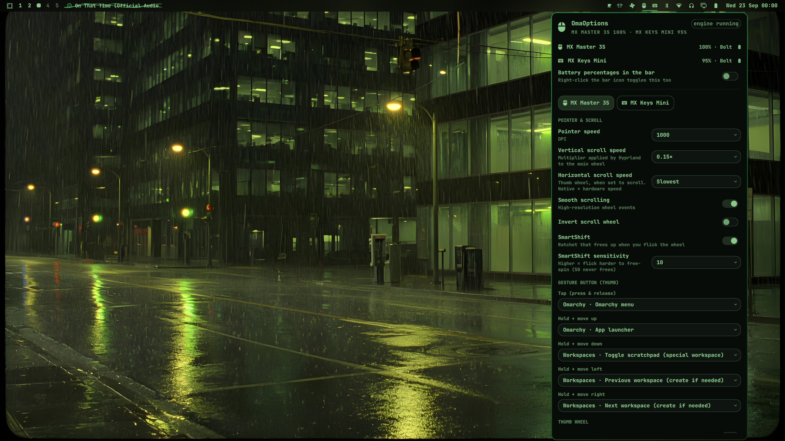
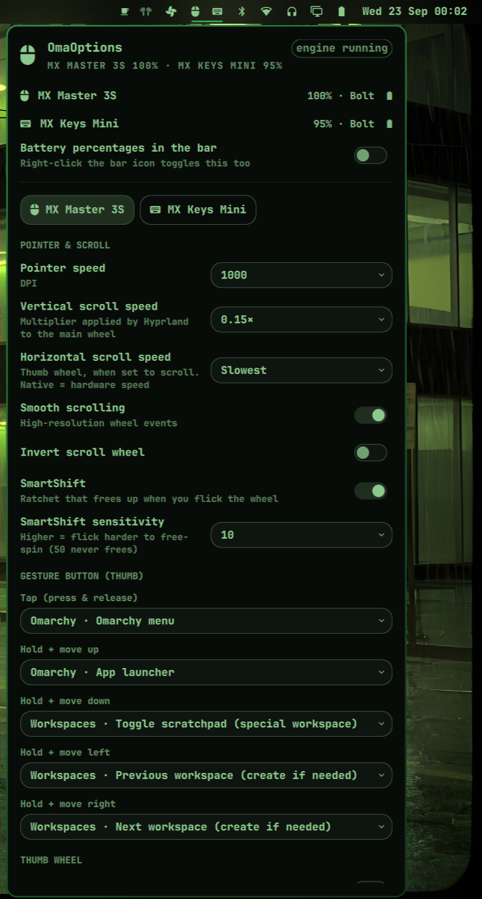
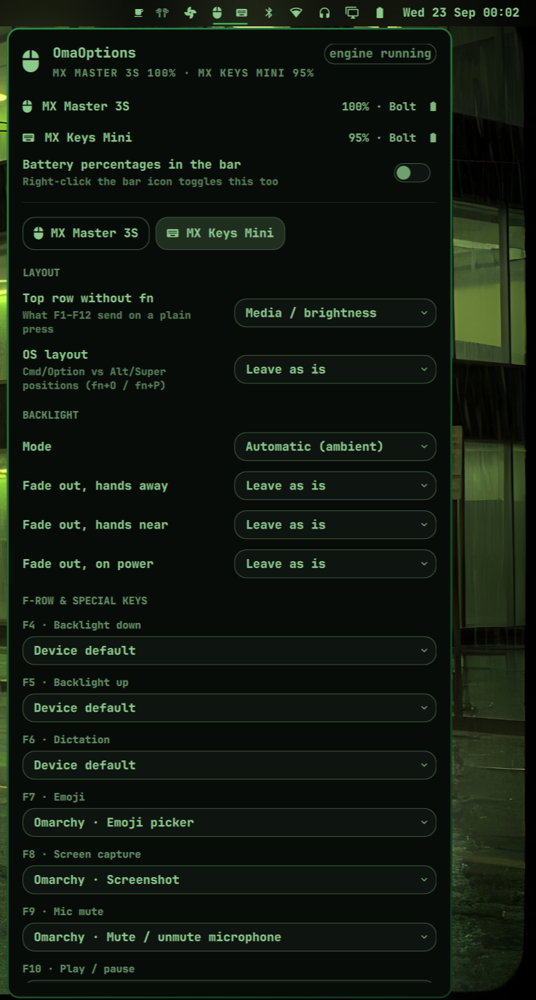

# OmaOptions

[](https://omarchy.org)
[](https://github.com/pwr-Solaar/Solaar)
[](https://wiki.hypr.land)
[](LICENSE)

Logi Options+ for the Omarchy shell. A bar widget that shows the battery of
your Logitech mice and keyboards and a settings panel that remaps their
gesture button, thumb wheel, buttons and F-row keys, and tunes DPI, scroll
speed, SmartShift, hi-res scrolling, fn-swap, OS layout and backlight.

Everything is discovered live: every Logitech mouse or keyboard that
[Solaar](https://github.com/pwr-Solaar/Solaar) can talk to shows up with the
controls that device actually reports, over a Logi Bolt or Unifying receiver,
Bluetooth or USB, several devices at once.



## Features

- **Battery in the bar** — one glyph per device with its charge, crossed out
  when a device is really gone. Right-click hides the percentages.
- **Gesture button** — tap, and hold-and-move up/down/left/right, each mapped
  to any action: workspaces, scratchpad, launcher, Omarchy menu, emoji
  picker, screenshot, media keys, editing shortcuts, DPI presets, host
  switching, or a custom shell command.
- **Thumb wheel** — native horizontal scroll, or each direction mapped to an
  action (workspace switching, tabs, zoom, volume…), with a separate
  horizontal speed.
- **Buttons and keys** — back, forward, wheel click, mode-shift, and every
  F-row / special key the keyboard's firmware can hand over (dictation, emoji,
  screen capture, mic mute, media keys, delete…). "Device default" keeps a
  key's built-in function.
- **Pointer and wheel** — DPI, vertical scroll speed (a per-device Hyprland
  scroll factor, so the touchpad is unaffected), smooth (hi-res) scrolling,
  wheel direction, SmartShift on/off and sensitivity.
- **Keyboard** — F-keys vs media keys without holding fn, OS layout
  (Linux / macOS / iOS / Chrome…), backlight mode, brightness and the three
  fade-out timers.
- **Per-device tabs** — one tab per device; settings that a device does not
  have are simply not shown. Settings for a device that is asleep are queued
  and written the moment it wakes up.
- Sleeping devices (Logitech drops the radio link after a few idle minutes)
  stay listed as connected with their last battery reading.




## Install

```bash
git clone https://github.com/andreinita21/omaoptions ~/.config/omarchy/plugins/andreinita21.omaoptions
bash ~/.config/omarchy/plugins/andreinita21.omaoptions/install.sh
```

The installer asks for your sudo password once. It installs `solaar` and
`python-evdev` from the official repositories, adds udev rules so your user
can talk to Logitech devices and to `/dev/uinput`, enables the
`omaoptions.service` user unit (the engine), puts the widget on the bar and
applies the defaults. Re-running it is safe.

Then click the mouse icon in the bar.

### Requirements

- Omarchy 4 (omarchy-shell bar widgets, Hyprland with Lua config)
- A Logitech mouse or keyboard that Solaar supports — in practice anything
  from the last ten years with HID++ 2.0: MX Master / Anywhere / Lift /
  Vertical, MX Keys / Keys S / Keys Mini / Mechanical, M-, K- and
  Signature-series, Ergo, Pebble…
- Logi Bolt, Unifying or Lightspeed receiver, or Bluetooth

## Using it

Every change is staged until you press **Apply**, which writes the settings
to the device, regenerates the rules and restarts the engine (a few seconds).
**Revert** drops staged edits; **Defaults** resets the current device to the
built-in defaults; **Doctor** opens a diagnostics dump in a terminal.

The defaults reproduce a Mac-like setup: gesture tap opens the Omarchy menu,
hold-up the launcher, hold-down the scratchpad, hold-left/right and the thumb
wheel switch workspaces; emoji, screen-capture and mic-mute keys do what they
say through Omarchy's own tools; smooth scrolling on with a gentle vertical
speed; F-row in media mode; backlight automatic.

Scroll speed lives in two places on purpose: **vertical** is a Hyprland
scroll factor applied only to the mouse; **horizontal** applies when the
thumb wheel is set to scroll, "Native" being the hardware speed and the other
levels an emulated step per so many units of rotation.

Everything the panel does is also available from the terminal:

```bash
omaoptions status     # battery / connection / engine state as JSON
omaoptions apply      # write settings + rules from config.json, restart the engine
omaoptions discover   # devices with their remappable keys and settings
omaoptions doctor     # everything you need for a bug report
```

## What it writes

| Path | Content |
|---|---|
| `~/.config/omarchy/omaoptions/config.json` | Your settings, per device. The single source of truth. |
| `~/.config/solaar/config.yaml` | Device settings, written through Solaar |
| `~/.config/solaar/rules.yaml` | Generated Solaar rules (gestures, keys, thumb wheel → actions) |
| `~/.config/hypr/omaoptions.lua` | Per-device vertical scroll factors, loaded from `hyprland.lua` |
| `~/.config/systemd/user/omaoptions.service` | The engine |
| `/etc/udev/rules.d/70-omaoptions.rules` | Device permissions |

The plugin owns `rules.yaml`; do not edit rules in the Solaar GUI at the same time.

## How it works

The engine is Solaar's own receiver listener, run headless as a user service
(`bin/omaoptions-daemon`): no root daemon, no tray icon. It applies the
persisted settings when a device connects, evaluates the rules
(`MouseGesture`, `Key`, thumb-wheel tests → `Execute`, `KeyPress`,
`MouseScroll`), and writes battery and connection state to a small status
file that the bar reads. Nothing in the bar ever polls the receiver, because
heavy HID++ traffic visibly stutters the pointer.

Compositor actions run `hyprctl dispatch` with Hyprland's Lua dispatcher
syntax. Key actions go through uinput.

`bin/omaoptions` (Python) turns `config.json` into Solaar settings and rules.
Remappable slots are derived from the key list each device reports, settings
from the setting list Solaar exposes for it, so a new model needs no code.

### Why not logiops

logiops 0.3 cannot ping devices through a Bolt receiver and, while it was
running, the MX Master 3S dropped clicks and scrolled uncontrollably. The
installer disables and masks `logid.service` if it finds one.

## License

MIT — see [LICENSE](LICENSE).
